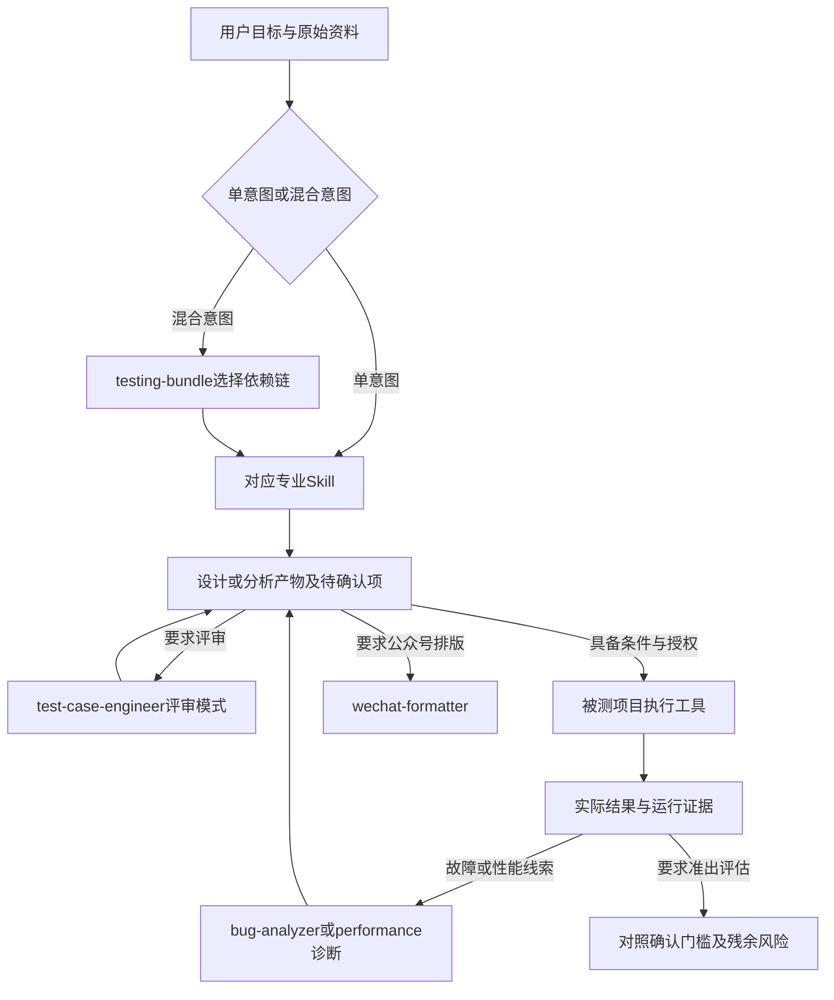

# 当前 Skill 工作流与 Token 使用报告

> 日期：2026-10-10（Asia/Singapore）。分析基线：`2f6617db8121aba4787b43a52ce82e86b208b3e4`，分支 `fix/skill-repair-20261009`。覆盖 testing 的7个Skill及独立的wechat-formatter；当前已修复版本以各SKILL.md的frontmatter为准。

## 1. 使用结论与范围

这些Skill主要提供分析、设计、评审和编排。实际业务测试执行依赖被测项目的入口、环境和授权；2个MCP是可选机器复核器。wechat-formatter是独立内容工具，不是每次测试交付的必经步骤。

按本报告参考路径，完整读取默认用例生成指令为28,585代理token，状态机为22,646，策略阶段1–4为7,889；这些都不是整次调用消耗。既有New短任务的实际累计input中位数为83,797.5，output中位数为1,247.5，主要还涉及宿主上下文、知识读取、工具结果和历史重复处理。

报告给出三类不同证据：文件及章节的分词测量、分析者制定的可见输出预算、既有调用的真实usage。没有把整次usage强行分摊给逻辑阶段，也没有新增模型评测、访问业务环境或修改Skill。



按目标只走相关分支；执行、评审、修复和公众号排版均不是每次分析任务的强制后续。

## 2. Token口径与计算方法

- **代理文本量**：tiktoken 0.14.0的`o200k_base`，实际运行分词器，非字符数乘系数。编码文件SHA256为`446a9538cb6c348e3516120d7c08b09f57c36495e2acfffe59a5bf8b0cfb1a2d`。未确认它是gpt-6.1-sol的原生编码，因此不能把代理量直接等同实际usage或账单。
- **阶段新增指令ΔS**：进入该阶段第一次读取的内容。章节策略只计相关章节且按行去重；整文件策略第一次读取文件即计全文，后续复用不再计新增文本。二者是两种读取策略，不是置信区间。
- **可见输出预算V**：供排期和设置交付规模使用的分析者估算，非历史均值、模型上限或保证值。一般按单功能10–20用例、单对象5–10状态/10–20转换、约200–500行diff、5–10模块策略；具体行另有说明。
- **实际usage**：只取经SHA及原始trace核对的`turn.completed.usage`。cached input属于input的子集，reasoning属于output的子集，不能重复相加；缺失usage不等于0。记录usage不等于最终费用。统计说明见[OpenAI官方usage文档](https://developers.openai.com/api/docs/guides/agents-api/observability)。
- **未计入静态文本量**：宿主系统/开发者指令、工具定义、其他已安装Skill、用户需求、代码/日志、对话历史、图片处理、工具返回及隐式推理；旧版chars×0.55的历史计划不作为本次测量基线。

```text
第j次模型请求输入 Ij = 宿主/工具上下文 Bj + 保留历史 Hj + 已加载Skill Sj + 任务资料 Dj + 工具结果 Wj
一次完整任务记录用量 T = ΣIj + ΣOj；cached input ⊆ Ij，reasoning ⊆ Oj
阶段新增ΔS可以相加得到唯一文本读取量；不能将其和整次累计input直接画等号。
```

阶段不是天然独立的一次模型请求。一次阶段可能有多次文件读取或工具往返，也可能多个阶段在一次请求中完成；相同历史会重复进入后续请求。输出usage还包含可见文字之外的模型生成内容，见[OpenAI计数文档](https://developers.openai.com/api/docs/guides/token-counting)。

## 3. Skill入口与资源体积

| Skill / 当前版本 | 用途 | 入口代理token | 全部目录Markdown代理token |
| --- | --- | --- | --- |
| [testing-bundle](../../../plugins/testing/skills/testing-bundle/SKILL.md) / 3.2.2 | 混合意图识别、链路编排与上下文交接 | 4,086 | 8,206 |
| [test-strategy-engineer](../../../plugins/testing/skills/test-strategy-engineer/SKILL.md) / 1.3.0 | 项目风险、测试分层、范围和准入准出 | 3,363 | 13,014 |
| [test-case-engineer](../../../plugins/testing/skills/test-case-engineer/SKILL.md) / 9.4.1 | 功能测试点、用例生成、已有用例评审 | 2,618 | 41,921 |
| [state-machine-test-engineer](../../../plugins/testing/skills/state-machine-test-engineer/SKILL.md) / 1.7.5 | 状态建模、完整性、适用场景和分层覆盖 | 3,420 | 44,518 |
| [change-impact-analyzer](../../../plugins/testing/skills/change-impact-analyzer/SKILL.md) / 1.3.0 | 固定diff范围、行为影响与覆盖缺口 | 2,414 | 15,838 |
| [bug-analyzer](../../../plugins/testing/skills/bug-analyzer/SKILL.md) / 1.2.3 | 复现、隔离、根因假设与验证边界 | 4,008 | 13,745 |
| [performance-test-engineer](../../../plugins/testing/skills/performance-test-engineer/SKILL.md) / 1.2.3 | 性能方案、资源/架构诊断与代码缺陷转交 | 2,443 | 13,424 |
| [wechat-formatter](../../../plugins/wechat-formatter/skills/wechat-formatter/SKILL.md) / 3.0.16 | 文章风格、排版校验及可选HTML导出 | 3,187 | 64,259 |

8个入口合计25,539；仅name+description的代理文本合计919。后者不是宿主实际发现清单长度：还有包装、其他Skill和工具定义。目录总量包括模板、演示、样式Markdown，排除README/CHANGELOG/docs；它是资源盘点，不是每次应读的负担。

## 4. 完整工作流及阶段预算

下表单位均为token。首阶段已包含入口；随后ΔS按该路径去重。章节/全文两列不应逐行取较小值拼成第三种预算：全文策略提前读过的内容在后续阶段可为0。输出预算只计该阶段新交付或定向修订，不假设每阶段重新打印完整前文。

### 4.1 testing-bundle：路由与协作

单一明确意图可直接进入专业Skill。混合任务按链路依赖执行；用户已授权的只读步骤连续完成，缺关键资料、范围改变或未授权操作才暂停。下面以链2读取为示例；专业处理成本在下游另计。

| 阶段 | 任务与产物 | 本阶段资源 | ΔS章节 / 全文 | 可见输出预算 |
| --- | --- | --- | --- | --- |
| 1 路由 | 匹配混合意图、消歧及选择链；本测量以链2为例 | 入口、mixed-intent-chains.md§链冲突裁定（多链同时命中）、mixed-intent-chains.md§链 2 | 4,692 / 6,605 | 150–400 |
| 2 交接与收口 | 传原始请求/上游产物/完成步骤/下游任务并汇总状态 | 复用已有资料 | 0 / 0 | 150–500 |

基础路径指令合计：章节4,692 / 全文6,605。下游不可用时交付可复用上游产物并披露中断，不把方向性模板称为已完成下游任务。

### 4.2 test-strategy-engineer：项目策略

默认走阶段1–4，阶段2–3后自检；用户只要风险矩阵、分层或门禁时聚焦对应阶段。资源/进度附录只在用户要求时加入。

| 阶段 | 任务与产物 | 本阶段资源 | ΔS章节 / 全文 | 可见输出预算 |
| --- | --- | --- | --- | --- |
| 1 项目特征 | 明确类型、生命周期、约束与默认假设 | 入口 | 3,363 / 3,363 | 300–800 |
| 2 风险矩阵 | 按事实评估5至10个模块；缺维度不填正式总分 | risk-matrix-framework.md | 1,823 / 1,823 | 700–1,800 |
| 3 测试分层 | 确定形状、层级职责、比例与投入依据 | test-pyramid.md | 1,493 / 1,493 | 500–1,200 |
| 4 范围与门禁 | 给出必测/选测范围、确认门槛与建议；不批准发布 | entry-exit-criteria.md | 1,210 / 1,210 | 600–1,600 |
| 5 资源附录（可选） | 基于团队及历史数据估算资源/进度 | strategy-templates.md | 2,657 / 2,657 | 500–1,500 |

基础路径指令合计：章节7,889 / 全文7,889。策略决定测什么及如何分层，详细功能用例转交用例Skill；没有执行证据不能给发布通过结论。

### 4.3 test-case-engineer：默认生成

需求理解 → 测试点 → 业务用例 → 自检。七维扫描、领域风险和待确认项随阶段传递；阶段3只为业务结果和必要检查点建立断言，不要求每步一验。

| 阶段 | 任务与产物 | 本阶段资源 | ΔS章节 / 全文 | 可见输出预算 |
| --- | --- | --- | --- | --- |
| 1 理解需求 | 确定业务对象、规则、可测性、来源与待确认项 | 入口、test-case-engineer-core.md§工作流概览、test-case-engineer-core.md§模式切换、test-case-engineer-core.md§阶段 1、project-knowledge.md | 6,719 / 11,184 | 500–1,500 |
| 2 提取测试点 | 七维扫描、风险分级、适用异常和领域缺陷对照 | test-case-engineer-core.md§阶段 2、test-levels.md、bug-patterns.md§通用缺陷模式、bug-patterns.md§缺陷模式 → 测试点映射 | 4,221 / 4,226 | 700–2,000 |
| 3 编写用例 | 将10至20个测试点落实为数据、操作、业务结果及必要检查点 | test-case-engineer-core.md§阶段 3、writing-rules.md、test-standards.md、prompt-strategy.md§核心理念、prompt-strategy.md§结构化提示词模板、prompt-strategy.md§Prompt 调优要点、prompt-strategy.md§AI 生成质量评估标准 | 11,778 / 11,630 | 2,500–6,000 |
| 4 自检补全 | 核对覆盖、可执行性、编排和待确认项，定向修订 | test-case-engineer-core.md§阶段 4、anti-patterns.md | 2,508 / 1,545 | 300–1,000 |

基础路径指令合计：章节25,226 / 全文28,585。产品知识存在且相关时补读；Office/PDF转换和shell速查按需。自检是自己产物的检查，不能替代独立评审或真人审核。

### 4.4 test-case-engineer：已有用例评审

R1解析 → R2十维评审 → R3意见/建议/度量。此路径不读取core生成流程；R2必要时抽取SemanticFacts并调用review-checker。

| 阶段 | 任务与产物 | 本阶段资源 | ΔS章节 / 全文 | 可见输出预算 |
| --- | --- | --- | --- | --- |
| R1 解析输入 | 解析10至20条已有用例、需求及增量范围；不进入生成流程 | 入口、review-mode.md§触发条件、review-mode.md§评审工作流（3 步）、review-mode.md§评审模式失败模式与 Fallback、review-mode.md§评审模式反例（不要做什么）、test-standards.md§优先级定义 | 5,440 / 12,704 | 300–800 |
| R2 十维评审 | 核对原文和SemanticFacts；可选MCP检查，候选与确认问题分开 | review-mode.md§MCP 增强（可选）、prompt-strategy.md§评审模式 · 语义事实抽取提示词 | 1,901 / 1,956 | 800–2,500 |
| R3 报告 | 输出意见、建议、度量、未评估维度和审核主体 | review-mode.md§评审意见表模板、review-mode.md§改进建议清单模板、review-mode.md§评审度量报告模板 | 1,325 / 0 | 500–1,500 |

基础路径指令合计：章节8,666 / 全文14,660。增量评审只覆盖指定diff。授权修订后走V1范围 → V2定向修订 → V3受影响维度复审 → V4修订报告，才补读必要core及writing-rules；本表不计可选修订轮次。

### 4.5 state-machine-test-engineer：状态型业务

识别 → 建模 → 模型自检 → C0与9项检查 → 十类适用性及场景 → 可选MCP复核/导出。场景级交付到此结束；明确要求步骤级用例才进入链5。

| 阶段 | 任务与产物 | 本阶段资源 | ΔS章节 / 全文 | 可见输出预算 |
| --- | --- | --- | --- | --- |
| 1 需求识别 | 识别对象、参与者、状态信号和歧义 | 入口、state-machine-core.md§阶段 1 | 4,054 / 7,559 | 400–1,000 |
| 2 建模 | 建立单对象5至10状态、10至20转换的模型及依据 | state-machine-core.md§阶段 2、state-modeling.md | 4,124 / 3,295 | 1,200–3,000 |
| 3 完整性 | C0及9项业务检查，区分结构与需求缺口 | state-machine-core.md§阶段 3、completeness-check.md | 3,857 / 3,196 | 600–1,800 |
| 4 场景穷举 | 先判10类适用性，再生成约15至30场景及未知项 | state-machine-core.md§阶段 4、scenario-types.md | 5,886 / 5,358 | 2,000–5,000 |
| 5 复核与收口 | 探测已暴露MCP；复核/导出/分层覆盖或诚实降级 | state-machine-core.md§阶段 5、anti-patterns.md | 4,027 / 3,238 | 300–1,000 |

基础路径指令合计：章节21,948 / 全文22,646。“10类”不等于每类必须一条。unknown/not_applicable分列；安全属性与有限流程结构结束检查不等于运行证明。读取矩阵允许按阶段读core章节；若将“始终必读core”理解为首次全文，使用全文列。

### 4.6 change-impact-analyzer：变更影响

范围固定 → 结构化Diff → 影响与覆盖两轮交叉 → 8段报告。Mode A只有代码事实/推断；Mode B有需求基线，可给需求×实现×测试追踪。

| 阶段 | 任务与产物 | 本阶段资源 | ΔS章节 / 全文 | 可见输出预算 |
| --- | --- | --- | --- | --- |
| 1 输入与范围 | 固定diff/ref和用例基线，缺必要输入即停止 | 入口、diff-modes.md、anti-patterns.md | 8,442 / 8,442 | 300–800 |
| 2 Diff解析 | 解析约200至500行diff，追踪两侧契约和影响链 | cross-impact-analysis.md | 3,281 / 3,281 | 800–2,000 |
| 3 交叉分析 | 两轮分析变更影响与覆盖缺口；区分Mode A/B | cross-analysis-guide.md | 734 / 734 | 1,000–3,000 |
| 4 报告 | 给出8段报告、可执行必测项、证据和限制 | report-template.md | 3,381 / 3,381 | 1,000–2,500 |

基础路径指令合计：章节15,838 / 全文15,838。缺diff或用例不继续交叉分析。静态文件和测试代码存在不证明执行通过；大diff分批并披露截断。Git采集始终禁止ext-diff/textconv。

### 4.7 bug-analyzer：根因与防御

复现 → 隔离 → 定位 → 验证 → 报告及防御性测试点。纯诊断或无修复权限可交付候选、未验证事项和最小验证动作。

| 阶段 | 任务与产物 | 本阶段资源 | ΔS章节 / 全文 | 可见输出预算 |
| --- | --- | --- | --- | --- |
| 1 复现 | 收集现象、环境、触发条件和最小复现；无权限则只分析 | 入口 | 4,008 / 4,008 | 400–1,000 |
| 2 隔离 | 沿调用边界缩小范围并查共享缺陷索引 | bug-patterns-index.md | 536 / 536 | 500–1,500 |
| 3 定位 | 用因果链/对照证据判断候选原因；不强凑五层 | root-cause-frameworks.md | 1,181 / 1,181 | 700–2,000 |
| 4 验证 | 已有授权时复验，否则交付证据缺口及最小验证动作 | 复用已有资料 | 0 / 0 | 500–1,500 |
| 5 报告 | 汇总根因状态、影响、修复建议、回归范围及防御性测试点 | report-template.md、defensive-test-points.md | 7,192 / 7,192 | 1,000–2,500 |

基础路径指令合计：章节12,917 / 全文12,917。共享缺陷库按具体领域/运行时错误补读，本表隔离阶段先计索引；不是必须全文扫描全部领域。仅要求根因或测试点时不自动生成完整用例。

### 4.8 performance-test-engineer：方案与诊断

plan走1–2并自检后结束；diagnose从3开始并做4的归属判断；plan-and-diagnose才走全路径。图中阶段4判断不代表一定加载Bug Skill。

| 阶段 | 任务与产物 | 本阶段资源 | ΔS章节 / 全文 | 可见输出预算 |
| --- | --- | --- | --- | --- |
| 1 需求与指标 | 确认场景、流量、SLA、环境及依据 | 入口、metrics-framework.md | 5,298 / 5,298 | 400–1,000 |
| 2 负载与场景 | 制定负载模型、流量配比、稳态/终止与采集条件 | load-models.md | 1,885 / 1,885 | 1,000–2,500 |
| 3 诊断 | 基于时间对齐的指标形成可证伪假设、归属与复测建议 | use-method.md、bottleneck-patterns.md | 4,328 / 4,328 | 1,000–3,000 |
| 4 转交 | 仅证据指向代码缺陷时转交Bug分析，否则本Skill收口 | 复用已有资料 | 0 / 0 | 150–500 |

基础路径指令合计：章节11,511 / 全文11,511。负载、RT/TPS/错误率、资源和依赖需要同时间窗交叉证据。工具不可用时给补采与可证伪假设；不自动执行压测，也不把方案当实测。

### 4.9 wechat-formatter：排版与HTML

内容分析 → 风格选择 → Markdown排版 → 内容/兼容校验 → 用户要求时HTML导出。快速模式已指定风格可跳过推荐；仅排版不运行HTML。

| 阶段 | 任务与产物 | 本阶段资源 | ΔS章节 / 全文 | 可见输出预算 |
| --- | --- | --- | --- | --- |
| 1 内容分析 | 对约3000个代理token的文章识别要素，保持原始事实 | 入口 | 3,187 / 3,187 | 200–500 |
| 2 风格匹配 | 推荐2至3个风格并依据用户选择继续 | template-index.md | 2,075 / 2,075 | 150–400 |
| 3 执行排版 | 仅加载所选tech-blog模板；本测量路径补读通用排版规则 | tech-blog.md、formatting-rules.md§§2 通用排版规则（所有风格适用）、formatting-rules.md§§3 风格适配规则 | 2,820 / 4,323 | 3,000–4,500 |
| 4 校验 | 核对内容、可读性与公众号兼容性，不外推发布结果 | formatting-rules.md§§4 质量校验清单（阶段 4）、wechat-markdown.md、wechat-traps.md | 3,607 / 3,100 | 250–800 |
| 5 HTML导出（可选） | 用户要求时运行净化脚本，仅返回文件及操作说明 | quickstart.md | 2,873 / 2,873 | 150–500 |

基础路径指令合计：章节11,689 / 全文12,685。本表采用tech-blog。只读一个所选模板；品牌及高级模块另加。HTML按运行脚本、不全文回传源码/HTML计；若代理全文读md2wechat.py，再增加7,993代理token。脚本/预览通过不等于公众号粘贴发布通过。

## 5. 按模式选择：不要默认跑最长路径

| 模式 | 参考范围 | 指令章节 / 全文 | 可见输出预算 |
| --- | --- | --- | --- |
| case-fast | 简单功能，3–5条用例 | 10,797 / 19,752 | 800–2,000 |
| case-regression | 纯重构回归清单 | 2,924 / 10,078 | 300–1,000 |
| case-exploration | 探索章程，领域清单另加 | 2,924 / 10,078 | 400–1,200 |
| case-review | 已有用例评审，不含修订 | 8,666 / 14,660 | 1,600–4,800 |
| performance-plan | 只设计性能方案 | 7,183 / 7,183 | 1,400–3,500 |
| performance-diagnose | 已有证据的性能诊断 | 6,771 / 6,771 | 1,150–3,500 |

快速生成参考路径仍全文读取writing-rules，属于保守路径，不是理论最低。回归/探索两种路径的全文列都包含整个core；按模式章节读才接近2,924。探索模式的数字只覆盖章程，不是完成探索执行。评审后的修订成本随修订范围及迭代次数增加，不能从仅评审预算中获得。

额外读取资源有明确触发条件，以下数值为首次全文阅读的代理量：

- 用例领域缺陷库全文：3,090，500/NPE/超时必查运行时章节；其他按领域选读。
- 用例格式示例：1,849，拿不准格式时。
- 用例shell速查：912，执行shell前。
- 状态机MCP配置速查：2,783，用户要求安装/配置；已有工具不额外安装。
- 高级模块定义+设计：9,130，使用:::module，仍按所需模块选读。
- 品牌规范+仓库示例配置：5,867，存在品牌配置；实际项目配置体积另计。
- 行业状态模板仅选对应对象，全文3,218–3,904；产品知识、项目.brand.md、需求及代码按实际文件计，不能从本仓库推定固定体积。
- 微信六种风格模板各1,152–2,950；已有风格选择时可省template-index的2,075，不能假定连同内容分析和校验都省略。
- 常规执行转换、MCP算法或HTML脚本本身没有LLM token计费；调用参数、返回内容及后续分析进入模型才产生token。MCP失败重试/差异复核仍可能增加模型轮次。

## 6. 七条协作链及交接成本

下表为各专业基础路径资源的**文件集合并集**，同文件只计一次，不包含业务资料和上游输出。它不是整次协作usage，也不假设所有转交都建立独立agent；独立agent会重新承担其系统/工具上下文。

| 链 | 顺序 | 指令全文并集 | 交接/停止条件 |
| --- | --- | --- | --- |
| 1 | Bug分析+用例 | 48,107 | 根因状态和防御性测试点不能变成已验证事实 |
| 2 | 策略+分层用例 | 43,079 | 保留风险、分层及未决规则，交付相应层用例 |
| 3 | 性能方案+诊断 | 18,116 | 同一个性能Skill内部完成，不重复加载两次入口 |
| 4 | 性能诊断+代码根因 | 26,293 | 先有性能证据且指向代码逻辑；否则不转交 |
| 5 | 状态机+完整用例 | 57,836 | 场景请求到状态机即停；只有完整用例请求才继续 |
| 6 | 评审+影响分析 | 37,103 | 先评审已有用例，再依据指定diff核实覆盖缺口 |
| 7 | 评审+故障根因 | 34,182 | 有实际故障证据才进入Bug；质量问题回用例修订 |

传递原始请求、已完成步骤、稳定产物及版本、待确认项和证据引用。优先传必要摘要及可读取的原始来源，避免每次复制整份上游报告；没有原文或可核对依据的摘要不能支撑confirmed结论。下游不可用时标协同中断，仍交付当前可用成果。

## 7. 整次任务预算示例：指令加载量如何放大

下面仅为规划演算：默认用例生成采用整文件读取，每阶段恰好一次模型请求；宿主及工具基数B设15,000，需求资料D设4,000并在各阶段保留，新增可见输出分别设1,000/1,500/4,500/650。这些是显式假设，不是从日志拆出的阶段usage。

| 阶段 | 累计Skill指令S | 前序可见产物H | 输入规划I | 新可见输出V |
| --- | --- | --- | --- | --- |
| 1 理解需求 | 11,184 | 0 | 30,184 | 1,000 |
| 2 提取测试点 | 15,410 | 1,000 | 35,410 | 1,500 |
| 3 编写用例 | 27,040 | 2,500 | 48,540 | 4,500 |
| 4 自检补全 | 28,585 | 7,000 | 54,585 | 650 |

上述输入规划合计168,719，可见输出合计7,650；已是176,369代理预算单位，还要考虑隐式推理、消息包装、工具结果以及新增模型轮次。它比“28,585+输出”大，原因是后续请求继续携带前文。缓存可能减少重复处理的费用/时延，但不能把usage中的缓存输入减成0；这里不推算货币或套餐额度。

任务资料规模建议先设工作包：小任务约1,000–3,000代理token，常规单功能约4,000–10,000，大日志/大diff超过20,000时分批并保留批次及缺口。该划分是管理输入规模的建议，不是模型容量或准确率阈值。用例/场景数量翻倍主要增加生成和核对工作，并不保证整次usage线性翻倍。

## 8. 已有真实usage：来源、结果及适用边界

使用2026-10-09冻结验收的411条唯一记录：288条任务（32题×3版本×3次）及123条触发分类（41题×3版本×1次）。本次逐条复核原始输出、prompt/invocation/trace/stderr等receipt哈希，以及usage与turn.completed一致；不计历史失败、已替代来源、裁判调用及补充v3评审。

执行模型为gpt-6.1-sol/high。New运行源8e55998与当前基线的Skill运行内容一致；后续差异为验收文档。每个Skill的12次New任务包含正常、反例、资料不足、协作/降级各3次，任务规模不同，不能据均值给Skill做性能排名。

| 记录类型 / 版本 | 次数 | 平均input | 平均output | 平均总量 | 缓存input占比 |
| --- | --- | --- | --- | --- | --- |
| task / old | 96 | 102,032 | 1,348 | 103,380 | 76.2% |
| task / new | 96 | 106,960 | 1,420 | 108,380 | 76.2% |
| task / no_skill | 96 | 14,697 | 796 | 15,493 | 71.7% |
| trigger / old | 41 | 13,377 | 83 | 13,460 | 36.9% |
| trigger / new | 41 | 13,374 | 82 | 13,455 | 43.9% |
| trigger / no_skill | 41 | 13,203 | 101 | 13,304 | 53.2% |

总量=input+output；缓存占比按该组Σcached/Σinput计算，不是费用节省率。reasoning_output是output的一部分。触发分类仅测metadata判断，既无完整阶段流程，也不是宿主native触发，不应套用其约1.34万总量来预测用例生成。

表中平均值与中位数四舍五入显示为整数，完整精度在JSONL中；范围是实际最小/最大值，不是置信区间。实际output不能由可见文字分词量精确还原，阶段预算V也没有包含未知的原生reasoning量。

| New Skill（各12次） | input中位数 | input实测范围 | output中位数 | reasoning中位数 | 命令事件总数 |
| --- | --- | --- | --- | --- | --- |
| testing-bundle | 103,593 | 32,140–427,247 | 1,462 | 381 | 86 |
| test-strategy-engineer | 76,878 | 56,532–77,458 | 1,597 | 254 | 57 |
| test-case-engineer | 112,785 | 86,589–212,571 | 1,154 | 194 | 72 |
| state-machine-test-engineer | 177,848 | 142,831–183,693 | 1,408 | 332 | 70 |
| change-impact-analyzer | 90,944 | 30,642–123,017 | 1,370 | 193 | 80 |
| bug-analyzer | 80,303 | 55,382–173,470 | 1,064 | 242 | 61 |
| performance-test-engineer | 74,063 | 72,356–76,280 | 1,167 | 141 | 53 |
| wechat-formatter | 73,872 | 50,598–147,686 | 790 | 172 | 75 |

命令事件是trace中的completed command_execution，不是模型请求数；读取多个文件可属于一个事件，也可能阶段内多次往返。No-skill仍可能受到宿主全局metadata影响；其平均input不是可从每条Skill调用中机械扣除的共同基数。New任务的96次共554个命令事件，也不能直接据此还原每阶段token。

| 正常样本（New各3次） | 任务 | input中位数 | output中位数 |
| --- | --- | --- | --- |
| testing-bundle | 重复扣款根因＋防御性用例（链1） | 425,754 | 5,376 |
| test-strategy-engineer | 支付风险、分层及准出证据 | 77,355 | 1,099 |
| test-case-engineer | 订单270元成功支付的一条用例 | 136,339 | 1,130 |
| state-machine-test-engineer | 审批合法场景及结构检查 | 177,812 | 1,421 |
| change-impact-analyzer | 优惠券上限patch与两条旧用例 | 93,102 | 1,389 |
| bug-analyzer | 两次回调/两条账务的只读诊断 | 80,847 | 1,032 |
| performance-test-engineer | 已给QPS/SLA的待执行方案 | 73,044 | 2,306 |
| wechat-formatter | 指定tech-blog的短文，仅Markdown | 55,037 | 577 |

例如bundle链1正常样本input为408,893–427,247，明显高于其入口4,086及静态链1并集48,107。相反，短Wechat文本也仍有约5.5万input：宿主、读取与历史不能忽略。以上是这批受控任务的观察范围，不是生产使用保证或按阶段的上限。

## 9. 怎样使用才能控制成本并保持质量

1. **先给完整工作包**：指定目标、需求/代码基线、输入路径、输出形式和授权范围；资料不足时只暂停依赖它的部分，不反复重启全流程。
2. **单意图直接调用**：明确只要用例、策略或性能诊断时不额外运行bundle；混合目标才保留编排。实际节省取决于宿主是否已经加载入口及后续轮次，不能承诺固定百分比。
3. **章节加载**：用例和状态机core、评审修订/增量说明按所需章节读取；格式规则、契约和真实风险依据不能为了减少token而省略。优先减少无关示例及所有风格/行业同时加载。
4. **控制工具输出**：rg定位后读相关片段；日志保留同一时间窗/trace，diff标明完整范围或截断。执行脚本/MCP后读取结构化结果，不把整个源码、HTML或历史trace全部打印回模型。
5. **复用可核对产物**：保留稳定ID、版本、待确认项和证据位置；变更后定向复审/回归，不让资料摘要丢失限定条件或越过用户授权。
6. **同时验收业务效果**：追踪返工、遗漏、错误验收、越界、降级可用性及完整任务usage。当前评测有269票持平、15票New较好、4票旧版更具体，不以指令减少或平均分代替质量证据。

当前仍需关注的工作流边界：准入准出知识存在通用硬阈值，与入口“项目门槛/模板建议分列”的口径不完全一致；bundle交接只有4个主要字段，版本/待确认项未形成强结构；执行记录不是通用执行平台契约。应先补这些衔接，再评估是否减少返工，不能只压缩SKILL.md。

## 10. 复核与后续采集方法

随报告保存的测量数据：[2026-10-10-skill-workflow-token-data.jsonl](2026-10-10-skill-workflow-token-data.jsonl)，SHA256=`889da2cfd8d9aafef60e9af82dc586a7a6d7815730e23804c0765df51b6146df`。包含8个版本、85个Markdown文件及SHA、44个阶段、14个模式、7条链、62组真实usage统计和4项可选实现检查；每个阶段的actual_stage_usage均为null。

完整测量程序、逐条usage导出及原始验收记录位于`/Users/lyle/.codex/artifacts/skill-usage-report-20261010`和`/Users/lyle/.codex/artifacts/skill-repair-20261009`。程序SHA256=`343946d7269c768da56e9ce214cfe8b5e3a955043dbd19383f40f7f473607a70`；本仓库数据保留复核结果，原始账务/业务材料未新增。

```bash
/tmp/my-skills-audit-20261009-venv/bin/python /Users/lyle/.codex/artifacts/skill-usage-report-20261010/measure.py
```

复跑依赖Python3.11、tiktoken0.14.0、PyYAML及完整归档。源码变化后应建立新报告版本，不能用旧SHA宣称是当前数据。该命令只测文本和验证历史产物，不调用模型；程序输出到仓库外归档。

后续若要获得真实阶段账，应由执行器为每次模型请求记录：task_id、skill/mode、stage_id、request_id、模型/effort、来源版本、读取范围、input/cached/cache-write/output/reasoning、工具输入输出摘要及重试原因。每个request_id只能计一次；混合阶段无法拆分时标mixed，不按输出长度比例分摊。输出截图、图片、隐式思考和未暴露的宿主开销以服务usage为准。

## 11. 来源与未验证项

- 当前8个SKILL.md、两个core、评审/规则/知识/模板文件：文件SHA及选定行范围见随附JSONL，资源以真实路径验证。文档旧版本说明不覆盖frontmatter版本。
- 原始冻结套件及最终验收：[evaluation-suite.json](../2026-10-09/evaluation-suite.json)、[behavior-validation.json](../2026-10-09/behavior-validation.json)。
- 官方统计口径：[Counting tokens](https://developers.openai.com/api/docs/guides/token-counting)、[Observability and usage](https://developers.openai.com/api/docs/guides/agents-api/observability)，于2026-10-10读取。没有查询或推算API价格、Codex套餐credits或剩余额度。
- 尚无阶段级原生usage；没有真实项目执行器/已连接MCP模式的token对照；没有所有模型、effort、宿主及大任务规模的实测；章节分词量不是精确原生模型输入。
- 公众号实际粘贴/发布、Windows原生安装及远程CI仍不在已验证范围；本报告未执行新业务测试或优化代码。
